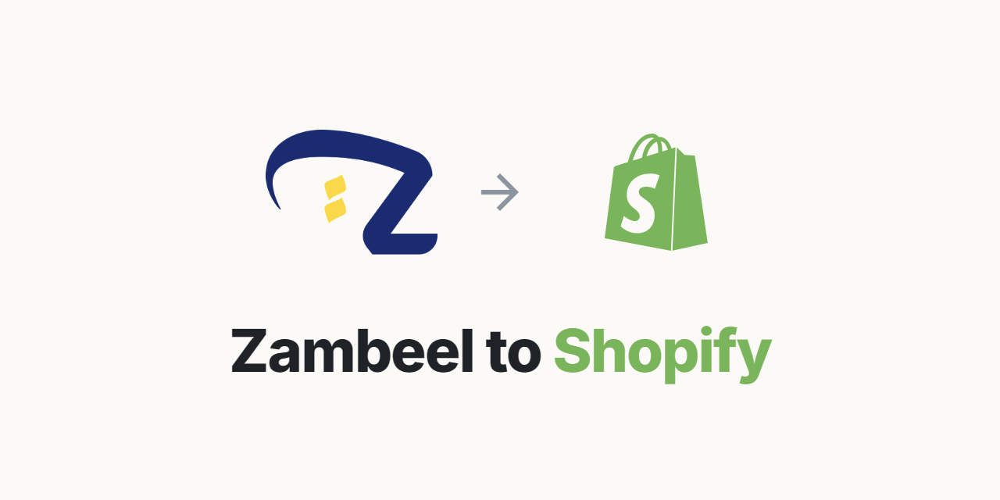

  

# Zambeel to Shopify

Free, open source Chrome extension that imports any [Zambeel](https://products.myzambeel.com) product into your Shopify store in one click: title, full description, every image, variants, SKUs and your marked-up prices. Built for Zambeel dropshippers in the UAE, Saudi Arabia and the rest of the GCC who are tired of downloading images and rebuilding products by hand.

## Features

- One-click Zambeel product import to Shopify, as Draft or Active
- All images, variants and Zambeel SKUs carried over, so forwarded orders credit your Zambeel account
- Prices prefilled from Zambeel cost times your markup
- Supplier name stripped from title, tags, alt text and description images
- Auto-published to your Online Store sales channel
- Works with the new Shopify Dev Dashboard apps (Client ID and Secret, token refresh handled for you)

## How it works

Zambeel's product site is a headless Shopify storefront. The extension pulls clean structured product data (title, full HTML description, all images, variants, wholesale costs, SKUs, tags) straight from their public Storefront API, then creates the product in your store through the Shopify Admin GraphQL API (`productSet`). Images are passed as CDN URLs, Shopify downloads them itself.

## Install (load unpacked)

1. Open `chrome://extensions` in Chrome.
2. Turn on **Developer mode** (top right).
3. Click **Load unpacked** and select this folder.

## One-time Shopify setup (new Dev Dashboard)

Shopify deprecated legacy in-admin custom apps on 1 Jan 2026. New apps are created in the Dev Dashboard, which uses OAuth client credentials instead of a static token. The extension handles the token exchange for you, so you only need a Client ID and Client Secret.

1. In your Shopify admin: **Settings > Apps and sales channels > Develop apps > Build apps in Dev Dashboard**.
2. **Create app**, name it "Zambeel Importer".
3. In the app, open **API access** (or Configuration) and add the Admin API scopes `write_products`, `read_products`, `write_publications` and `read_publications`. Save. (The publications scopes let imports publish to your Online Store automatically.)
4. **Install** the app on your store (select the store, approve).
5. In the app's **Settings** / Overview, copy the **Client ID** and **Client secret**.
6. Click the extension icon > gear, enter your store's `.myshopify.com` domain, paste the Client ID and Client secret, and hit **Test connection**.

The extension trades the Client ID + Secret for a 24-hour Admin API token and refreshes it automatically before it expires. Both credentials live only in your browser's local extension storage and are sent only to your own store domain.

> Use the `.myshopify.com` domain, not a custom domain like `yourstore.com`. Your admin URL `admin.shopify.com/store/<handle>` maps to `<handle>.myshopify.com`.

## Daily use

1. Browse any product on `products.myzambeel.com`.
2. Click the extension icon.
3. Review: your **default market** (set in settings, e.g. KSA) is pre-selected and the other country is unticked automatically. Each kept variant shows its **SKU** (pre-filled from Zambeel, editable) and price. Edit the title, adjust sell prices (prefilled at your default markup times cost), and change the selection if this product is an exception.

> The SKU is critical: it must match Zambeel's code so your forwarded orders credit your Zambeel account. The importer carries it over automatically and shows it for confirmation; only change it if you have a reason to.
4. Click **Add to my Shopify store**. Products are created as Draft by default so you can review before publishing.
5. Use the direct link to open the new product in Shopify admin.

Zambeel's meta option "Country where you want to sell?" is stripped automatically when your selection leaves only one country, so your customers never see it.

### Dropshipping privacy

The importer removes every trace of the supplier so customers can't tell you're dropshipping:

- **Vendor** is set to your own brand name (from settings), never Zambeel.
- The word "Zambeel" is stripped from the title, tags, and image alt text.
- Images embedded in the description (which hotlink Zambeel's CDN and expose their store id) are moved into your product gallery, so Shopify re-hosts them under your own store domain.

### Manual tools

Even without connecting Shopify, the popup can:

- download all product images to `Downloads/Zambeel/<product>/`
- copy the description as rich HTML (pastes formatted into Shopify's editor)
- copy the title

## Notes and limitations

- Zambeel costs are in AED. The extension writes plain numbers as prices; your store's own currency applies. Set your prices accordingly.
- Variants import with inventory not tracked (`inventoryPolicy: CONTINUE`) so they are sellable immediately and never show as sold out.
- Each import is published to the **Online Store** sales channel automatically (draft or active), so products are never stuck with no channel selected. Requires the publications scopes above.
- The original Zambeel product link is saved on each product as a private **"Zambeel source"** metafield (namespace `zambeel.source_url`, type `url`). It's admin-only (storefront access NONE), so customers never see it, and it gives you a one-click way back to the supplier listing to check stock and price. Toggle it off in settings if you don't want it. Needs a one-time metafield definition on the store (name "Zambeel source", owner Product, type URL, pinned); the extension writes the value with the `write_products` scope you already have.
- The Shopify token is minted from your Client ID + Secret and auto-refreshes every 24 hours; you never handle it directly.
- No auto-sync: if Zambeel changes a price or goes out of stock, your store does not update.
- If Zambeel rotates their public storefront token, fetching will break. Fix: open their site, find the new token in the JS bundle (search `X-Shopify-Storefront-Access-Token`), update `ZAMBEEL_TOKEN` in `background.js`.
- Icons are generated by `node tools/gen-icons.js`.

## Files

- `manifest.json` - Manifest V3 config
- `background.js` - service worker, all API calls (Zambeel fetch, Shopify import)
- `popup.*` - product preview, pricing, import UI
- `options.*` - store connection and defaults

## Contact

Questions, ideas or bugs: [hello@moetalaat.com](mailto:hello@moetalaat.com)

## License

MIT
